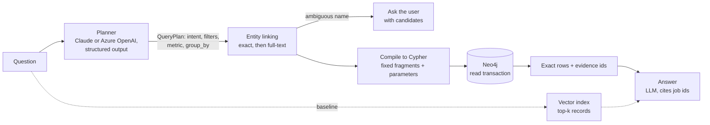

# graphrag-neo4j

[](https://github.com/MurtazaBhutta/graphrag-neo4j/actions/workflows/ci.yml)


**Natural-language questions over 53,000 field-service records, answered from a Neo4j knowledge
graph and benchmarked against plain vector RAG on the same data, database and embedding model.**

Neo4j · vector + full-text indexes · Claude or Azure OpenAI (structured outputs) · FastAPI · fastembed
(bge-small, CPU) · pytest · Docker Compose · GitHub Actions

---

## The result

25 questions a facilities manager would ask, each with a gold answer computed independently in
plain Python. *Sufficient* means the retrieved context holds everything needed to answer exactly
(the definition is below).

| 53,018 jobs | vector RAG, k=10 | vector RAG, k=50 | vector RAG on notes, k=10 | **graph RAG** |
|---|---|---|---|---|
| **Sufficient, all 25** | 0 | 0 | 0 | **21** |
| Lookup by job id (3) | 0 | 0 | 0 | **3** |
| Relationships (5) | 0 | 0 | 0 | **5** |
| Aggregations (10) | 0 | 0 | 0 | **10** |
| Repeat failures (3) | 0 | 0 | 0 | **3** |
| Semantic, mean recall (2) | 0.00 | 0.00 | 0.17 | **0.58** |
| Semantic + filters, mean recall (2) | 0.27 | 0.47 | 0.00 | **0.73** |
| Median context tokens | 741 | 3,754 | 733 | **138** |
| p50 retrieval latency | 16 ms | 21 ms | 15 ms | 27 ms |

What the numbers say:

- **Counting, ranking and joining are not retrieval problems.** "How many emergency call-outs in
  2025?" depends on about 4,000 records. Top-k returns 10 or 50 of them, and a bigger k only
  makes the prompt bigger (3,754 tokens, still 1% recall). The graph answers with one exact
  number in about 140 tokens.
- **Filters beat similarity.** "Which Meridian Hotels jobs in 2025 involved water through a
  ceiling?" is a structured filter plus a semantic condition. Vector search ranks other
  customers' leaks highly (the theme is planted 24 times across customers). Filtering in the
  graph first and then ranking by similarity lifts recall from 0.20 to 0.80
  ([ADR 0003](docs/adr/0003-filter-in-the-graph-then-rank.md)).
- **Semantic search is still the hard part, for both.** The planted notes are worded to share
  almost no keywords ("smell of melting plastic in the riser cupboard", "hot electrical odour"),
  and a 33M-parameter CPU model does not rank all of them in the top 10. This repo reports that
  rather than tuning the test set until it passes.
- **Exact identifiers defeat dense embeddings.** The lookup misses are real, but adding BM25 to
  the baseline would fix them. They are not the argument for a graph; the aggregation rows are.

Full per-question results: [`benchmark/results/`](benchmark/results). Reproduce them with
`make up load bench`.

### How it is scored, and why that is fair

- **Same database, same model.** Both pipelines query one Neo4j instance with the same
  `BAAI/bge-small-en-v1.5` embeddings. The baseline embeds **whole job records** (customer, site,
  asset, engineer, fault, cost, parts, notes), so it has every fact; it lacks only structure. It
  is also run against a notes-only index and at k=50, and every variant is reported
  ([ADR 0002](docs/adr/0002-a-fair-baseline.md)).
- **No LLM grades anything.** For structured questions the graph is *sufficient* only if its
  result **equals** the reference executor's result: every row, every value, every evidence id.
  The vector baseline is *sufficient* if **every** record the answer depends on is in its
  context, which is the most generous reading. Whether a model then adds up 340 rows correctly
  is not charged to it.
- **Gold plans isolate retrieval.** The table uses labelled plans. `make bench-live` has a live model
  (Claude, or Azure OpenAI with `PLANNER=azure_openai`) produce the plans instead and reports exact plan-match accuracy. That run needs an API key and
  is not in CI; I have not published its numbers.

## How it works



**The model never writes Cypher** ([ADR 0001](docs/adr/0001-typed-plans-not-text-to-cypher.md)).
It fills in a typed `QueryPlan` with four intents (`job_detail`, `list_jobs`, `aggregate`,
`repeat_visits`). Metrics, groupings, asset types and statuses are closed enums. Names, dates and
free text travel only as query parameters, and incoherent plans are rejected before anything
runs. A prompt-injected question therefore cannot become `DETACH DELETE`, and each intent's Cypher
is small enough to test exhaustively.

**Names are linked, not trusted.** "Meridan Hotels" resolves through a full-text index with
fuzzy matching, but only when the best hit clearly beats the runner-up. Otherwise the API
answers with a clarification and the candidates. A confident answer about the wrong customer is
the worst failure a system like this can have.

### The graph

```
(Customer)<-[:BELONGS_TO]-(Site)<-[:INSTALLED_AT]-(Asset)
(Job)-[:AT_SITE]->(Site)   (Job)-[:ON_ASSET]->(Asset)   (Job)-[:ATTENDED_BY]->(Engineer)
(Job)-[:USED_PART {qty}]->(Part)   (Job)-[:FOLLOW_UP_OF]->(Job)
```

The data is a seeded, synthetic portfolio: 40 customers, 374 sites, 1,155 assets, 120
engineers, 23 parts and 53,018 jobs over two years. Busy sites get more work, about 6% of jobs
are return visits, and a few assets fail again and again. Three free-text themes are planted in
a handful of jobs and serve as the semantic gold set. The same seed gives the same world on any
machine, and a test enforces that across Python processes.

## Correctness: Cypher checked against an independent implementation

`reference.py` answers every `QueryPlan` in plain Python over the in-memory world. It shares no
query code with `cypher.py`. The integration suite asserts the two agree exactly on:

- every structured benchmark question, and
- **300 random plans** across every intent, metric, grouping and filter combination.

That is how the "graph answers exactly" column is earned. Making it pass found real bugs while
building: a vector index silently kept from an earlier load with different dimensions, and a
`set` whose iteration order changed between Python processes, which made the "deterministic"
world differ between the loader and the benchmark. Both now have tests.

## Run it

```bash
make install
make up            # Neo4j in Docker (browser at http://localhost:7474, neo4j / graphrag-dev)
make load          # generate and load 53k jobs; the first run embeds them (slow on CPU, cached after)
make bench         # the table above; add --k 50 or --vector-index notes via the CLI
make test          # unit tests, no database
make test-integration
```

Everything is also in Compose:

```bash
docker compose up --build -d --wait
docker compose run --rm api python -m graphrag load --jobs 50000
curl -X POST localhost:8000/query -H 'Content-Type: application/json' \
  -d '{"intent": "aggregate", "group_by": "site", "limit": 5,
       "filters": {"date_from": "2025-01-01", "date_to": "2025-12-31"}}'
```

| Endpoint | What it does | Needs a model key |
|---|---|---|
| `POST /query` | run a `QueryPlan` directly; returns rows, value, evidence and the Cypher | no |
| `POST /ask` | question → plan → Cypher → answer with citations; `mode: "vector"` for comparison | yes (Claude or Azure OpenAI) |
| `GET /health` | database reachability and which world is loaded | no |

With a model configured: `python -m graphrag ask "Which Meridian Hotels assets keep failing?"`.

### Model providers

The planner and the answer writer have two implementations with the same prompts and the same
`QueryPlan` schema. `GRAPHRAG_LLM_PROVIDER` picks one:

| `GRAPHRAG_LLM_PROVIDER` | Settings |
|---|---|
| `anthropic` (default) | `ANTHROPIC_API_KEY` |
| `azure_openai` | `AZURE_OPENAI_ENDPOINT` (`https://<resource>.openai.azure.com`), `AZURE_OPENAI_API_KEY`, `AZURE_OPENAI_DEPLOYMENT` |

Azure OpenAI is called through the v1 API with the `openai` SDK, so no `api-version` is needed.
The deployment must support structured outputs (for example gpt-4o 2024-08-06 or later, gpt-4.1
or the gpt-5 family). Without either provider configured, `/query` and `/health` still work and
`/ask` says what is missing. `make bench-live PLANNER=azure_openai` scores the Azure planner
against the gold plans the same way.

## Tests and CI

| | |
|---|---|
| `test_integration.py` | Cypher = reference on all benchmark questions and 300 random plans; filters respected by semantic search; typo-tolerant linking; ambiguous names refused |
| `test_cypher_safety.py` | an injection string in every free-text field never appears in the query text; every metric × grouping compiles |
| `test_datagen.py` | same world across processes and hash seeds; planted phrasings appear only in planted jobs |
| `test_bench_scoring.py` | the scoring rules, and the gate fails on a wrong graph answer |
| `test_llm_and_api.py` | planner and answer-writer request shape and refusal handling for Claude and Azure OpenAI (fake clients); provider selection; API status codes |

CI runs three jobs: **unit** (lint plus 44 tests, no database), **integration** (Neo4j service,
5,000-job world, fails if any test was skipped, then the benchmark gate), and **Docker** (build
the image, load data in the container, smoke-test the API).

## Limits

- Background notes come from templates (738 distinct texts), so many jobs share identical notes.
  That makes semantic search harder than real data would, and it badly hurts the HNSW index (see
  ADR 0003).
- One embedding model, chosen to run on a laptop CPU. A larger model would raise the semantic
  numbers for both pipelines; it would not change the aggregation rows.
- Four intents. Questions outside them get "can't plan that", not an improvised query. That is
  a deliberate trade, and it is also a coverage limit.
- Embedding 53k records on CPU took about 40 minutes the first time; later loads use the cache
  and take about a minute.

## Background

This is a clean-room rebuild of a pattern I shipped in production: natural-language Q&A over
50k+ service records, with RAG over Neo4j-modelled business relationships, which cut decision
query time by 40%. That system used LangChain and Azure OpenAI. This repo uses the Neo4j driver
and the Anthropic SDK directly, so every query is visible. All data here is synthetic, and no
employer code or data is included.

Related: [django-invoice-agent](https://github.com/MurtazaBhutta/django-invoice-agent) ·
[agent-guardrail-runtime](https://github.com/MurtazaBhutta/agent-guardrail-runtime) ·
[llm-release-gate](https://github.com/MurtazaBhutta/llm-release-gate)

MIT licensed.
